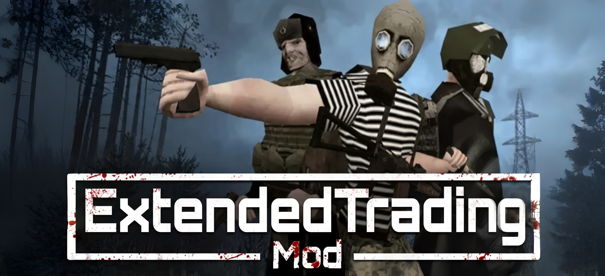

---

# ExtendedTrading for MISERY (UE4SS)

[English](#english) | [Русский](#русский)

---

<a name="english"></a>
# 🇬🇧 English

**ExtendedTrading** is a comprehensive economic overhaul for the standalone game **MISERY** (Unreal Engine). 

In the vanilla game, trade is broken and asymmetrical: vendors sell items they refuse to buy back, essential equipment cannot be liquidated, and inventories are tiny and erratic. **ExtendedTrading** completely revamps the bunker economy in *Sirzez Undergrounds*, turning each vendor into a specialized merchant with a fully mirrored inventory and balanced price margins.

### ✨ Key Features
* **100% Mirrored Inventories:** Every single item a vendor sells (`Buy` tab) is now accepted for purchase (`Sell` tab). No more hoarding items that nobody wants to buy.
* **Balanced Economy (Anti-Exploit):** 
  * Vendor Selling Price: **Base Cost + 35% markup**
  * Vendor Buyback Price: **Base Cost × 55%**
  * Profit margin guarantees you cannot buy and resell items for infinite money loops.
* **Strict Merchant Specialization:** No redundant duplicate items across vendors. Each merchant has an exclusive market role.
* **Massive Expansion:** More than 100+ vanilla items that were previously unobtainable or unsellable have been carefully integrated into the market.
* **Co-op Compatible:** Works in multiplayer sessions (requires all players to have identical files).

---

### 📦 Installation Guide

#### Prerequisites:
1. Make sure you have **UE4SS (v3.0.1 or compatible)** installed in your game directory:  
   `MISERY/MISERY/Binaries/Win64/ue4ss/`

#### Step-by-Step Installation:
1. Download the mod archive.
2. Extract the `ExtendedTrading` folder directly into your UE4SS mods directory:
   ```text
   MISERY/MISERY/Binaries/Win64/ue4ss/Mods/ExtendedTrading/
   ```
   *The folder structure should look like this:*
   ```text
   ue4ss/Mods/ExtendedTrading/
   ├── enabled.txt
   └── scripts/
       ├── main.lua
       └── database.lua
   ```
3. Open `MISERY/MISERY/Binaries/Win64/ue4ss/mods.txt` and ensure this line is present:
   ```text
   ExtendedTrading : 1
   ```
4. **IMPORTANT (Conflicts):** If you previously used `SellThemAll` or another vendor mod, completely remove or disable it (delete its folder or remove its `enabled.txt`).

---

### 📋 Full Vendor Breakdown (Changelog)

#### 1. Barman (`BP_Barman_C_1`) — Civil Food, Drinks, Seeds & Cigarettes
* **What he now BUYS (Sell Tab):** All civilian foods and beverages can now be sold to him. This includes Vodka, Beer, Energy Drinks, Cola, Kvas, Champagne, Clean Water, Cigarettes, Good/Small/Rusted Canned Stew, MRE, Sausages, Cheeses, Condensed Milk, Good Zucchini, Canned Pickles, and Canned Tomatoes.
* **What he now SELLS (Buy Tab):** Added all 4 farm seed types (Carrot, Cucumber, Tomato, Wheat), fresh vegetables (Cucumbers, Tomatoes, Carrots), canned vegetable jars, Cola, Kvas, Champagne, Sausages, and Cheeses.
* **Removed / Excluded:** Raw mutant carcasses and raw monster meat belong exclusively to the Hunter.

#### 2. Gun Dealer (`BP_GunDealerReal_C_1`) — Military Firearms, Ammo & Explosives
* **What he now SELLS (Buy Tab):** He now sells fully operational, battle-ready firearms: PM, TT-33, PPSH, Kiparis, AK-74, Saiga-12, AS VAL, SVD, as well as heavy armaments: PKM machine gun and RPG-7.
* **What he now BUYS (Sell Tab):** All ammunition boxes (9mm, Buckshot, 5.45, 7.62, 9x39), all corresponding weapon magazines, RGD-5 grenades, and Anomaly Detectors can now be sold back for cash.
* **Removed / Excluded:** Civilian hunting guns (TOZ, Mosin, Sawn-off) moved to the Hunter. Broken frames and scrap gun parts moved to the Technician.

#### 3. Hunter (`BP_Hunter_C_1`) — Mutant Trophies, Meats & Hunting Weapons
* **What he now SELLS (Buy Tab):** Hunting arsenal (TOZ shotgun, Mosin rifle, Sawn-off Obrez, Hunter Knife, Combat Knife, Splitting Axe), raw meats (Deer, Swamper, Cockroach), Zone delicacies (Crab Caviar, Dried Fish), and various harvested mutant trophies.
* **What he now BUYS (Sell Tab):** Cooked dishes (Cooked Deer/Swamper meat), hunting knives, axes, Mosin rifles, and all high-tier monster parts (Wendigo Horns, Chuvirla Fists/Heads, Screamer Organs, Twins Heads/Feet, Crab Legs/Eyes).

#### 4. Medic (`BP_Medic_C_2`) — Pharmaceuticals & Anomaly Artifacts
* **What he now SELLS (Buy Tab):** All anomalous artifacts can now be purchased directly (Calculator, Soap, Iron, Star, GP-5 Filter, Yola, Dosimeter, Toy Truck, Clocks, Rubik's, Nevolyashka, Shkatulka). Added UN Military/Light Medkits, Empty/Full Blood Packs, and Adrenaline.
* **What he now BUYS (Sell Tab):** Surpluses of bandages, medkits, vitamins, anti-radiation injectors, and anti-depressants can now be liquidated for profit.

#### 5. Resource Supplier / Scrapper (`BP_ResourseSaler_C_3`) — Raw Materials & Construction Tools
* **What he now SELLS (Buy Tab):** Construction tools (Shovels, Wrenches, Crowbars, Sledgehammers, Handsaws, Scythes, Pitchforks, Hoes, Rakes), base storage furniture (Small/Medium Storage Boxes, Wooden Crates), Cement, and Iron.
* **What he now BUYS (Sell Tab):** You can now sell back all excess scrap, raw wood, glass, plastic, cement bags, iron, gasoline, coal, and scavenging tools.
* **Removed / Excluded:** Precision electronics and gun parts moved to the Technician. Domestic debris moved to Vasya.

#### 6. Technician (`BP_Technician2_C_1`) — Electronics, Weapon Components & Gunsmithing
* **What he now SELLS (Buy Tab):** Electronics, wires, radio components, lightbulbs, drills, duct tape, advanced repair toolboxes, locksmith kits, gun cleaning kits, armor plates, gunpowder, individual firearm parts (Pistol, Shotgun, Rifle, Assault Rifle), and broken weapon frames (`Resource_Weapon_*`).
* **What he now BUYS (Sell Tab):** All weapon parts, broken gun receivers, electronics, and repair toolboxes can now be sold directly for rubles.

#### 7. Vasya (`BP_Vasya_C_5`) — Outfitter, Armor, Backpacks & Domestic Junk
* **What he now SELLS (Buy Tab):** Full range of backpacks (School, Soviet, Hunter, Tactical, Hiking, Large, UN Tactical), advanced gas masks (Respirator, Standard, Hamster, PMK-2, Military, M50), specialized environmental suits (Hazmat, Soviet/UN Hazmat), military uniforms, body armor vests, and helmets.
* **What he now BUYS (Sell Tab):** You can sell any gas mask, suit, rig, backpack, sewing kit, or scavenged domestic trash item (`Resource_ItemTrash_01-09`, `Resource_Musor`, `Resource_OldPhoto`).

---

<a name="русский"></a>
# 🇷🇺 Русский

**ExtendedTrading** — это масштабная переработка экономической системы для отдельной игры **MISERY** (движок Unreal Engine).

В оригинальной игре торговля была нелогичной и асимметричной: торговцы отказывались выкупать вещи, которые сами же продавали, найденный ценный лут было некому сдать, а ассортимент лотов был скудным. Мод **ExtendedTrading** превращает бункер *Сирзез* в живой рынок с зеркальными витринами и честным экономическим балансом.

### ✨ Особенности мода
* **100% Зеркальная торговля:** Любой предмет, который торговец продает (вкладка «Купить»), он гарантированно готов у вас выкупить (вкладка «Продать»).
* **Защита от бесконечных денег (Маржа цен):**
  * Цена продажи торговца: **Себестоимость + наценка 35%**
  * Цена скупки торговцем: **Себестоимость × 55%**
  * Скупка в 2.5 раза дешевле продажи исключает возможность перепродажи предметов ради наживы.
* **Чёткая специализация без дубликатов:** Ни один предмет не повторяется у разных продавцов. У каждого NPC своя торговая ниша.
* **Более 100+ новых товаров в обороте:** Всё, что раньше лежало мёртвым грузом в инвентаре (мусор, детали оружия, одежда, артефакты, инструменты), теперь имеет реальную ценность.
* **Совместимость с кооперативом:** Работает в мультиплеере при условии, что мод установлен у всех игроков в сессии.

---

### 📦 Инструкция по установке

#### Требования:
1. Установленный **UE4SS (версия 3.0.1 или совместимая)** в папке игры:  
   `MISERY/MISERY/Binaries/Win64/ue4ss/`

#### Пошаговая установка:
1. Скачайте архив с модом.
2. Распакуйте папку `ExtendedTrading` прямо в директорию модов UE4SS:
   ```text
   MISERY/MISERY/Binaries/Win64/ue4ss/Mods/ExtendedTrading/
   ```
   *Структура файлов должна быть следующей:*
   ```text
   ue4ss/Mods/ExtendedTrading/
   ├── enabled.txt
   └── scripts/
       ├── main.lua
       └── database.lua
   ```
3. Откройте файл `MISERY/MISERY/Binaries/Win64/ue4ss/mods.txt` и убедитесь, что в конце есть строка:
   ```text
   ExtendedTrading : 1
   ```
4. **ВАЖНО (Конфликты):** Если у вас стоял мод `SellThemAll` или другой мод на торговлю, **удалите его папку** или сотрите в ней файл `enabled.txt`, иначе старый мод перезапишет торговцев обратно!

---

### 📋 Полный список изменений по каждому продавцу

#### 1. Бармен (`BP_Barman_C_1`) — Еда, Напитки, Семена и Сигареты
* **Что начал скупать (вкладка «Продать»):** Водку, пиво, энергетики, колу, квас, шампанское, воду, сигареты, тушёнку всех видов, ИРП (MRE), колбасу, сыр, сгущёнку, кабачковую икру, солёные огурцы и помидоры из банок.
* **Что начал продавать (вкладка «Купить»):** Все 4 вида семян для огорода (морковь, огурец, томат, пшеница), свежие овощи, закатки, колу, квас, шампанское, колбасу и сыр.
* **Что убрано/перенесено:** Сырое мясо и туши мутантов исключены из его ассортимента (это ниша Охотника).

#### 2. Оружейник (`BP_GunDealerReal_C_1`) — Боевое оружие, Боеприпасы и Гранаты
* **Что начал продавать (вкладка «Купить»):** Полноценное рабочее оружие: ПМ, ТТ-33, ППШ, Кипарис, АК-74, Сайга-12, АС ВАЛ, СВД, а также тяжёлое вооружение: пулемёт ПКМ и гранатомёт РПГ-7.
* **Что начал скупать (вкладка «Продать»):** Все патроны (9мм, дробь, 5.45, 7.62, 9x39), магазины под любые пушки, гранаты РГД-5 и детекторы аномалий.
* **Что убрано/перенесено:** Гражданские ружья (ТОЗ, Мосинка, Обрез) переданы Охотнику. Сломанные стволы и запчасти переданы Технику.

#### 3. Охотник (`BP_Hunter_C_1`) — Мутанты, Мясо, Ножи и Ружья
* **Что начал продавать (вкладка «Купить»):** Охотничье оружие (ТОЗ, Мосинка, Обрез, охотничьи ножи, колун), сырое мясо мутантов и дичи, деликатесы (икра краба, сушёная рыба), трофеи и части тел мутантов.
* **Что начал скупать (вкладка «Продать»):** Приготовленное мясо мутантов, ножи, топоры, ружья, а также редкие трофеи (рога вендиго, кулаки и головы чувырлы, лёгкие крикуна, конечности близнецов).

#### 4. Медик (`BP_Medic_C_2`) — Медицина и Артефакты
* **Что начал продавать (вкладка «Купить»):** Все 12 аномальных артефактов (Калькулятор, Мыло, Утюг, Звезда, Фильтр ГП-5, Юла, Дозиметр, Грузовик, Часы, Кубик Рубика, Неваляшка, Шкатулка), военные аптечки, аптечки ООН, пакеты с кровью и адреналин.
* **Что начал скупать (вкладка «Продать»):** Излишки любых бинтов, витаминов, обычных/автомобильных/военных аптечек, антирада и антидепрессантов.

#### 5. Снабженец сырьем (`BP_ResourseSaler_C_3`) — Ресурсы и Строй-инструмент
* **Что начал продавать (вкладка «Купить»):** Рабочий инструмент (лопаты, гаечные ключи, ломы, кувалды, ножовки, косы, вилы, мотыги, грабли), ящики для хранения лута на базе, цемент и железо.
* **Что начал скупать (вкладка «Продать»):** Любой найденный инструмент, доски, металлолом, пластик, стекло, канистры с бензином, мешки с углем.
* **Что убрано/перенесено:** Детали оружия и микросхемы убраны к Технику. Бытовой мусор убран к Василию.

#### 6. Техник (`BP_Technician2_C_1`) — Запчасти оружия, Сломанные пушки и Электроника
* **Что начал продавать (вкладка «Купить»):** Электронику, провода, радиодетали, лампочки, дрели, синюю изоленту, наборы инструментов, слесарные комплекты, оружейную химию, порох, бронепластины, запчасти к оружию всех классов и сломанные каркасы оружия (`Resource_Weapon_*`).
* **Что начал скупать (вкладка «Продать»):** Все вышеперечисленные детали, поломанные стволы и радиоэлектронику.

#### 7. Вася / Барахольщик (`BP_Vasya_C_5`) — Одежда, Броня, Противогазы и Хлам
* **Что начал продавать (вкладка «Купить»):** Огромный выбор рюкзаков (от школьного до тактического ООН), противогазы (Хомяк, ПМК-2, М50 и др.), химзащиту (комбинезоны), военную форму, разгрузки, бронежилеты, шлемы и каски.
* **Что начал скупать (вкладка «Продать»):** Любые противогазы, любые рюкзаки, одежду, бронежилеты, швейные наборы и весь найденный бытовой мусор (`Resource_ItemTrash_*`, старые фото, бытовой сор).

---

### ⚖️ License & Credits
* Developed for **MISERY** by Platypus Entertainment.
* Built using the **RE-UE4SS** Framework.